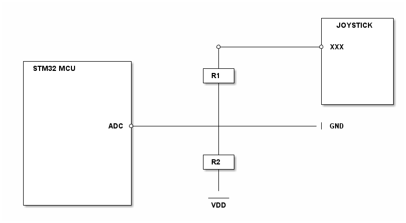

# __Joystick Part Drivers__


[](https://htmlpreview.github.io/?https://github.com/STMicroelectronics/stm32-joystick-part-drivers/blob/main/Release_Notes.html)

## Overview

The Joystick part drivers provides APIs to drive a joystick in various ways.


## Description

### MFXSTM32L152 flavor

This driver relies on an MFXSTM32L152 part driver to function.

After the MFXSTM32L152 object has been initialized, the associated resources can be assigned to Joystick MFX objects. This is done in `joy_mfx_io_init()`, which the user application must override.
That function is called by `joy_mfx_init()`; the `.id` field of the `joy_mfx_t` structure must be used to discriminate the resources to be assigned.

To use the JOY MFX part APIs, the application must define the `joy_mfx_t` object and the `joy_mfx_io_init()` function to assign MFX resources to it.
The link between the two is made by `joy_mfx_init()`, which must be called after all the MCU peripherals and the IO Expander have been initialized.

### ADC flavor

This driver operates through an ADC interface, performing single conversion operations with a 12-bit resolution in polling mode.

After the MCU IPs have been initialized, the associated resources can be assigned to Joystick object. This is done in `joy_adc_io_init()`, which the user application must override.
That function is called by `joy_adc_init()`; the `.id` field of the `joy_adc_t` structure must be used to discriminate the resources to be assigned.

To use the JOY ADC part APIs, the application must define the `joy_adc_t` object and the `joy_adc_io_init()` function to assign adc handler to it.
The link between the two is made by `joy_adc_init()`, which must be called after all the MCU peripherals and the ADC peripheral have been initialized.

This code may be generated by STM32CubeMX2, or written manually in the software project.

Once this is successfully done, all the other part APIs can be used freely.

All joystick pins (except the common pin connected to GND) are connected to the ADC pins with individual resistors for each pin to form a voltage divider with a common resistance connected the VDD.

the `joy_adc_get_state` function determinate the key state based on joystick ADC Key Value.

#### Joystick ADC Key Value Calculation

As an example with the generic setup below, to calculate the Joy "XXX" key value, follow these steps:

Calculate the Input Voltage (vin):

```c
float Vin = (R1 / (R1 + R2)) * Vmax;
```

R1 and R2 are the resistor values in the voltage divider.

Vmax is the maximum voltage.

Calculate the Key Value key_val:

```c
float key_xxx_val = ((Vin / Vref) * Resolution);
```

Vin is the input voltage calculated in the previous step.

Vref is the reference voltage for the ADC.

Resolution is the ADC resolution (e.g., 1024 for a 10-bit ADC).

Finally, Determine the key value and apply the necessary tolerance:

```c
pjoy->key_xxx_min_val = key_xxx_val - tolerance;
pjoy->key_xxx_max_val = key_xxx_val + tolerance;

```

NOTE: XXX can be LEFT, RIGHT, CENTER, UP or DOWN JOY PIN.

<!--
@startuml
@startditaa{doc/generic_hardware_setup.png}

                                                            +-------------+
                                                            |  JOYSTICK   |
                                                            |             |
                                                            |             |
                                        *-------------------* XXX         |
                                        |                   |             |
  +--------------------+                |                   |             |
  | STM32 MCU          |             +--+--+                |             |
  |                    |             | R1  |                |             |
  |                    |             +--+--+                |             |
  |                    |                |                   |             |
  |                    |                |                   |             |
  |                    |                |                   +-------------+
  |                    |                |
  |                    |                |
  |                ADC *----------------+-------------------| GND
  |                    |                |
  |                    |                |
  |                    |                |
  |                    |             +--+--+
  |                    |             | R2  |
  |                    |             +--+--+
  |                    |                |
  |                    |                |
  |                    |                |
  |                    |              -----
  +--------------------+               VDD

@endditaa
@enduml
-->
